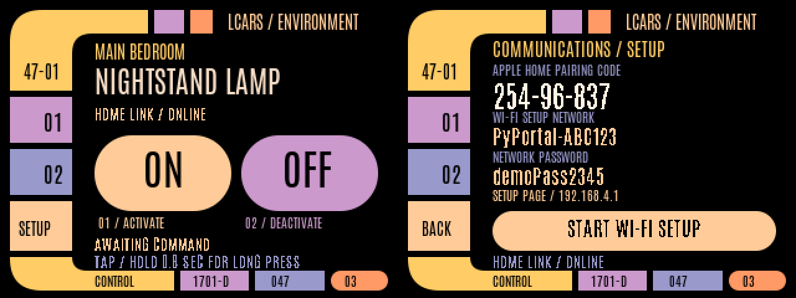

# pylcars

A TNG-style LCARS touchscreen remote for Apple Home, running on an original
[Adafruit PyPortal](https://www.adafruit.com/product/4116).

The PyPortal presents two programmable HomeKit buttons. Assign their actions in
Apple Home to control a light or run a scene. The screen and HomeKit connection
run on the two processors already on the board. After setup, it needs USB power,
Wi-Fi, and an existing HomePod or Apple TV home hub.



*The preview contains synthetic setup credentials. Room and lamp labels are examples.*

## Controls

- Tap **ON** or **OFF** to send Button 1 or Button 2's Single Press action.
- Hold for **0.8 seconds** to send that button's Long Press action. A progress
  bar fills during the hold. Releasing afterward does not send another tap.
- Tap **SETUP** to view pairing and Wi-Fi provisioning details.
- The sidebar's **01** and **02** also activate the corresponding buttons.

Double presses are not implemented. **SENT** means the controller queued an
event for HomeKit. The display does not read back the lamp's actual state.

## How it works

| Component | Role |
| --- | --- |
| SAMD51 / CircuitPython | Display, resistive touch, tap/hold recognition |
| Onboard ESP32 / [HomeSpan](https://github.com/HomeSpan/HomeSpan) | Wi-Fi, HomeKit pairing, programmable-button events |
| Existing Apple Home hub | Runs the actions assigned to each button |

The processors communicate over the PyPortal's existing UART wiring. No
soldering or additional bridge computer is required. This replaces the ESP32's
stock AirLift/NINA firmware, so programs using `adafruit_esp32spi` require the
stock firmware to be restored first.

## Versions

| Dependency | Version used |
| --- | --- |
| CircuitPython for original PyPortal | 10.3.1 |
| Arduino CLI | 1.5.1 |
| Arduino-ESP32 | 3.3.8 |
| HomeSpan | 2.1.8 |

ESP32 profile: original ESP32, 4 MB flash, DIO at 40 MHz, `min_spiffs`, no PSRAM.
The build script targets Apple Silicon macOS. Other hosts can use Arduino CLI
with the same dependencies and board options.

## Install

1. Build and install the ESP32 firmware using [the firmware guide](docs/firmware.md).
2. Restore [CircuitPython 10.3.1 for PyPortal](https://downloads.circuitpython.org/bin/pyportal/en_US/adafruit-circuitpython-pyportal-en_US-10.3.1.uf2).
3. With **CIRCUITPY** mounted on the Mac, run from this repository directory:

   ```bash
   bash Install_LCARS.command
   ```

   The installer backs up the display files it replaces, copies assets and
   libraries first, then installs `code.py`. It does not flash the ESP32.

4. Join the setup Wi-Fi network shown on the screen. Open `http://192.168.4.1`
   if a setup page does not appear, then enter the home network's 2.4 GHz Wi-Fi details.
5. Rejoin your home Wi-Fi on your phone. Add **PyPortal Lamp Buttons** in Apple
   Home with the code shown on the device.
6. Assign **Button 1 / Single Press** and **Button 2 / Single Press** to the
   intended On and Off actions. Assign **Long Press** separately for either button.

For manual installation, copy the contents of `CIRCUITPY/` onto the drive,
libraries and the `lcars/` assets first, `code.py` last. Do not create another
`CIRCUITPY` folder inside the drive.

## Build and test

```bash
bash Build_Controller.command
# Once the pinned dependencies are installed:
bash Build_Controller.command --offline

python3 -m unittest discover -s tests -p 'test_*.py' -v
c++ -std=c++11 tests/protocol_test.cpp -o /tmp/pylcars-protocol-test
/tmp/pylcars-protocol-test
```

The 14 Python tests cover framing, status freshness, compatibility, tap/hold
timing, contact loss, and cancellation. The C++ test checks UART commands.
These host tests do not replace testing on the board.

The original two-button prototype was tested with Apple Home. Firmware 0.3 was
compiled, flashed, and verified with saved settings preserved. The new LCARS
interface and long-press behavior are still undergoing device testing.

## Customize the display

The room and lamp labels are in `design/build_assets.py`. With ImageMagick
installed, rebuild the static backgrounds and font atlases:

```bash
python3 design/build_assets.py
python3 design/preview.py
```

The preview renders the actual layout with host substitutes for `displayio`.
The board loads pre-rendered backgrounds and compact one-bit font atlases.

## Private files

Wi-Fi credentials and HomeKit pairing data are saved on the ESP32 during setup,
not in the source. Flash dumps and NVS backups can contain those credentials.
Keep `nvs.bin`, logs, backups, `secrets.py`, and `settings.toml` out of commits.
The repository's `.gitignore` excludes them, along with toolchains and firmware
build output. Only the three generated font atlases are allowed `.bin` assets.

The original board-specific flashing scripts, device identifier, local paths,
and private settings backups are intentionally absent from this repository.

## Credits

- [HomeSpan](https://github.com/HomeSpan/HomeSpan), including its programmable-switch example. Upstream MIT notice is in `licenses/HomeSpan-MIT.txt`.
- Adafruit CircuitPython and the included touchscreen driver. Driver MIT notice is in `licenses/Adafruit-Touchscreen-MIT.txt`.
- [Antonio](https://github.com/google/fonts/tree/main/ofl/antonio) font and derived bitmap atlases. SIL OFL notice is in `licenses/Antonio-OFL.txt`.
- LCARS visual reference: [TheLCARS.com](https://www.thelcars.com/). This is an independent fan project.
